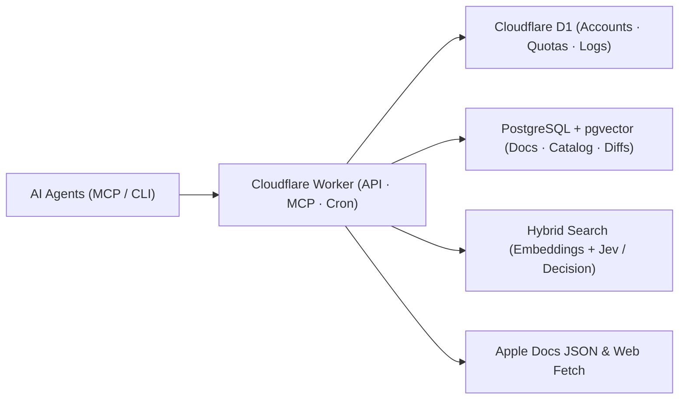

<div align="center">

<a href="https://apple-rag.com">
  
</a>

# Apple RAG

**Apple developer documentation and WWDC transcripts for AI agents — via MCP or CLI.**

[Website](https://apple-rag.com) · [Connect Guide](https://apple-rag.com/connect) · [Docs Pulse](https://apple-rag.com/updates) · [CLI on npm](https://www.npmjs.com/package/apple-rag-cli) · **English** | [简体中文](./README.zh-CN.md)

[](https://github.com/BingoWon/apple-rag-mcp/actions/workflows/ci.yml)
[](https://github.com/BingoWon/apple-rag-mcp/releases)
[](https://www.npmjs.com/package/apple-rag-cli)
[](https://mcp.apple-rag.com/.well-known/mcp.json)
[](./LICENSE)
[](https://mcpservers.org/servers/bingowon/apple-rag-mcp)

Powered by [ **Jev**](https://typesafe.ai/) &amp; RAG hybrid retrieval

<br>

<a href="https://apple-rag.com">
  
</a>

<br>

| `376,000+` | `1,880+` | `395,000+` | `Every 5 min` |
| :---: | :---: | :---: | :---: |
| **Apple Doc Pages** | **WWDC Videos** | **Indexed Chunks** | **[Live Docs Radar](https://apple-rag.com/updates)** |

</div>

---

## Quick Start

> [!TIP]
> **No account or API key required to try.** Start immediately with anonymous access (30 calls/week). Sign in at [apple-rag.com/overview](https://apple-rag.com/overview) anytime for personalized prompts, MCP tokens, authorized IPs, and higher limits.

### Option 1: MCP (Recommended)

Connect any MCP-capable agent directly to `https://mcp.apple-rag.com` (Streamable HTTP), or copy a tailored setup prompt from the [connection guide](https://apple-rag.com/connect).

<p>
  <a href="https://cursor.com/en/install-mcp?name=apple-rag-mcp&config=eyJ1cmwiOiJodHRwczovL21jcC5hcHBsZS1yYWcuY29tIiwiaGVhZGVycyI6eyJYLUFwcGxlLVJBRy1DbGllbnQiOiJjdXJzb3IifX0%3D">
    
  </a>
  &nbsp;
  <a href="https://apple-rag.com/connect">
    
  </a>
</p>

**Claude Code**

```bash
claude mcp add-json --scope user apple-rag-mcp '{"type":"http","url":"https://mcp.apple-rag.com","headers":{"X-Apple-RAG-Client":"claude"}}'
```

**Codex (`~/.codex/config.toml`)**

```toml
[mcp_servers.apple-rag-mcp]
url = "https://mcp.apple-rag.com"

[mcp_servers.apple-rag-mcp.http_headers]
X-Apple-RAG-Client = "codex"
```

<details>
<summary><strong>VS Code, Windsurf, Cline, Antigravity &amp; generic MCP JSON</strong></summary>

```json
{
  "mcpServers": {
    "apple-rag-mcp": {
      "type": "http",
      "url": "https://mcp.apple-rag.com"
    }
  }
}
```

- **Transport:** Streamable HTTP (`https://mcp.apple-rag.com`)
- **Protocol:** Stateless MCP `2026-07-28`, with legacy `initialize` support (`2025-11-25`, `2025-06-18`, `2025-03-26`)
- **Auth (optional):** Add `Authorization: Bearer <MCP_TOKEN>` from your [dashboard](https://apple-rag.com/mcp-tokens) or authorize your IP at [apple-rag.com/authorized-ips](https://apple-rag.com/authorized-ips)

</details>

### Option 2: CLI (Shell-based Agents)

For agents with shell access (Node.js 22.20+), [`apple-rag-cli`](https://www.npmjs.com/package/apple-rag-cli) exposes the exact same three tools plus a bundled [`apple-dev-docs` agent skill](./skills/apple-dev-docs/SKILL.md).

```bash
npm install -g apple-rag-cli

# Try immediately without signing in
apple-rag search "SwiftUI NavigationStack path binding" --limit 3 --json

# Link your account via browser OAuth PKCE / Device Grant when needed
apple-rag auth login
```

See [`packages/cli/README.md`](./packages/cli/README.md) for exit codes, `--output`, unattended automation keys, and agent skill setup.

---

## Three Tools, One Workflow

Both MCP and CLI expose the same focused surface so agents pull only the official context they need:

| Tool | Purpose | Example |
| --- | --- | --- |
| `search` | Hybrid keyword + semantic search across Apple docs & WWDC transcripts (English queries) | `apple-rag search "StoreKit Transaction currentEntitlements" --limit 4` |
| `browse` | Explore SwiftUI & UIKit topic trees without guessing documentation URLs | `apple-rag browse "https://developer.apple.com/documentation/swiftui/view" --depth 1` |
| `fetch` | Read full documentation or supported public webpages with source & retrieval provenance | `apple-rag fetch "https://developer.apple.com/documentation/swiftui"` |

```text
Agent task: "How do I bind NavigationStack path state on iOS 26/27?"

1. search("SwiftUI NavigationStack NavigationPath binding")
   └─▶ Hybrid recall (exact symbol + pgvector) ─▶ Ranked by Jev ─▶ Top official passages + URLs
2. browse("https://developer.apple.com/documentation/swiftui/navigation")   [optional]
   └─▶ Official SwiftUI topic hierarchy & related symbols
3. fetch("https://developer.apple.com/documentation/swiftui/navigationstack")
   └─▶ Full page content, availability & code examples with canonical Apple source URL
```

---

## Why Apple RAG

- **Hybrid Retrieval + Decision Model Ranking** — Combines exact symbol/lexical matching with 2560-dim `pgvector` semantic recall, then ranks candidates with [ **Jev**](https://typesafe.ai/) against your query's API, platform, and OS version constraints. Requests from mainland China route automatically to Microsoft Decision 1.1 via ZenMux, with Qwen fallback if the primary ranker is unavailable.
- **Apple Docs Pulse (Live Documentation Radar)** — A continuous 5-minute `ETag` collector monitors Apple framework roots and release notes, records structured diffs, deprecations, and beta changes, and publishes automated daily/weekly bilingual AI trend digests plus RSS/JSON feeds at [**apple-rag.com/updates**](https://apple-rag.com/updates).
- **4-Stage Resilient `fetch`** — Resolves pages in order from the indexed corpus → fresh cache → official Apple DocC JSON → live extraction fallback, returning provenance metadata while keeping third-party pages strictly outside the Apple search index.
- **Zero-Friction Compatibility & Isolated Credentials** — Supports modern stateless MCP `2026-07-28` alongside legacy `initialize` handshakes so Cursor, Claude Code, Codex, and VS Code connect out of the box. MCP tokens, authorized IPs, CLI device sessions, and automation keys are independently revocable while sharing one account quota.

---

## Plans & Shared Quotas

All tool calls (`search`, `browse`, `fetch`) share a single account allowance across MCP connections, CLI devices, and automation keys. Retrieval model calls are included.

| Plan | Weekly Quota | Rate Limit | Pricing |
| --- | ---: | ---: | --- |
| **Anonymous Trial** | 30 calls | 3 / min | Free — no sign-up |
| **Free Account** | 50 calls | 5 / min | Free ([Sign up](https://apple-rag.com/register)) |
| **Pro** | 50,000 calls | 50 / min | **$1 / week** (Card &amp; Alipay · subscription or one-time pass) |
| **Enterprise** | Custom | Custom | [Contact us](https://apple-rag.com/#pricing) |

---

## Architecture & Repository

The hosted service at [apple-rag.com](https://apple-rag.com) manages the corpus, continuous collector, vector database, and retrieval model credentials. The complete application source is open in this repository:



| Path | Description |
| --- | --- |
| `worker/` | Cloudflare Worker runtime — MCP server (`2026-07-28` + legacy), REST & CLI OAuth APIs, hybrid search engine, Docs Pulse collector |
| `src/` | React 19 + Vite + Tailwind CSS v4 frontend — website, `/connect`, `/updates` radar, user dashboard, admin console |
| `packages/cli/` | Standalone [`apple-rag-cli`](https://www.npmjs.com/package/apple-rag-cli) npm package |
| `shared/` | Pure cross-runtime contracts, tool metadata, and datetime helpers |
| `skills/` | Agent skill definition (`skills/apple-dev-docs/SKILL.md`) |
| `ops/` | Architecture guide ([`ops/architecture.md`](./ops/architecture.md)), PostgreSQL schemas, and operational playbooks |

### Local Development

```bash
pnpm install
pnpm verify   # Parallel lint, typecheck, and core tests
pnpm dev      # Start local Vite + Worker dev server
```

---

## License

Licensed under the [MIT License](./LICENSE).

<div align="center">

<br>

**Better docs. Better context. Better code.**

[Get Started →](https://apple-rag.com) · [Explore Docs Pulse →](https://apple-rag.com/updates)

</div>
