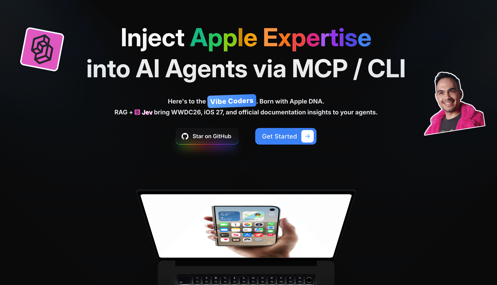

<div align="center">

<a href="https://apple-rag.com"></a>


# Apple RAG

### Apple developer knowledge for your AI agent.

*Give your agent Apple documentation and WWDC26 transcripts through MCP or CLI. RAG retrieval finds the sources, and [Jev](https://typesafe.ai/) ranks the results.*

[Website](https://apple-rag.com) · Powered by [ Jev](https://typesafe.ai/)

[](https://github.com/BingoWon/apple-rag-mcp/actions/workflows/ci.yml) [](LICENSE) [](https://mcpservers.org/servers/bingowon/apple-rag-mcp) · **English** | [中文](./README.zh-CN.md)

</div>

---

## What your agent can do

Choose the tool that fits the question. A single call can be enough.

| Tool | When to use it |
| --- | --- |
| `search` | Find an API or a WWDC discussion with an English query. Keyword and semantic search find relevant passages. |
| `browse` | Explore SwiftUI or UIKit without guessing URLs. Follow Apple’s topic groups from a framework to its APIs. |
| `fetch` | Read the source page for a search result or catalog entry, or open a URL you already have. |

All three tools are available through MCP and the CLI. The [dashboard](https://apple-rag.com/overview) shows calls by tool, links to the corresponding logs, and your remaining weekly allowance.

### Powered by [ Jev](https://typesafe.ai/)

[Jev](https://typesafe.ai/), a decision model, scores candidate Apple documentation
and video transcripts against each query's API, platform, and version requirements.
We use its relevance scores to rank the sources returned through MCP or CLI. A backup
reranker takes over if the API call fails.

---

## Hosted and Ready to Use

The [hosted service](https://apple-rag.com/) connects your agent to an Apple knowledge base that is already collected, cleaned, and indexed.

- **Ready-to-query sources:** Official developer documentation and video transcripts, available through one connection.
- **Retrieval model calls included:** Embeddings, [Jev](https://typesafe.ai/) ranking, and the backup reranker run on our service.
- **Ongoing upkeep:** We handle content collection, index updates, database backups, and protocol compatibility.

The hosted service operates the database, refreshes the corpus, and manages retrieval model credentials. The CLI is distributed separately; the application source is public.

When reading a page, `fetch` checks the index first, follows Apple redirects, and can fall back to official document JSON or live extraction. Results identify the source and retrieval method. Third-party pages stay outside the Apple search index. See [web retrieval operations](ops/web-retrieval.md) for limits and log details.

[Start free](https://apple-rag.com/). [Pro](https://apple-rag.com/#pricing) includes 50,000 tool calls/week and 50/minute for $1/week, shared by `search`, `browse`, and `fetch`.

---

## Connect your agent

Open the [connection guide](https://apple-rag.com/connect), copy a setup prompt, and paste it into your agent’s conversation.

- **MCP** is the recommended choice for agents with native MCP support. To use your account allowance, copy the personalized prompt from your [dashboard](https://apple-rag.com/overview).
- **CLI** gives shell-based agents the same tools. The [npm package](https://www.npmjs.com/package/apple-rag-cli) includes the CLI and an agent skill. You approve account access in your browser.

The English [client guides](https://apple-rag.com/#quickstart) cover Codex, Claude Code, OpenCode, Pi, Antigravity, Cursor, VS Code, and Cline.

### One-click setup for Cursor

[Install in Cursor](https://cursor.com/en/install-mcp?name=apple-rag-mcp&config=eyJ1cmwiOiJodHRwczovL21jcC5hcHBsZS1yYWcuY29tIiwiaGVhZGVycyI6eyJYLUFwcGxlLVJBRy1DbGllbnQiOiJjdXJzb3IifX0%3D)

Open [Cursor](https://cursor.com) and confirm installation.

### Manual setup for other MCP clients

**JSON Configuration (Copy & Paste):**
This is a configuration example, not a universal client format. The dashboard
also retains manual configuration examples.

```json
{
  "mcpServers": {
    "apple-rag-mcp": {
      "type": "http",
      "url": "https://mcp.apple-rag.com"
    }
  }
}
```

**Manual Configuration Parameters:**
- **MCP Type:** `Streamable HTTP`
- **URL:** `https://mcp.apple-rag.com`
- **Protocol:** `2026-07-28`, with legacy `initialize` support for `2025-11-25`, `2025-06-18`, and `2025-03-26`
- **Authentication:** `Optional` (MCP Token for higher limits)
- **MCP Token:** Get yours at [apple-rag.com](https://apple-rag.com) for increased quota

Saving a configuration alone does not verify a working connection.

> **Note:** No MCP Token required to start! You get free queries without any authentication. Add an MCP Token later for higher usage limits.

## 🌟 Built for AI agents

<table>
<tr>
<td width="50%">

### ⚡ **Fast & Reliable**
Get quick responses with our optimized search infrastructure. No more hunting through docs.

### 🎯 **AI-Powered Hybrid Search**
Hybrid search combines keyword and semantic retrieval for Apple documentation and video transcripts. [Jev](https://typesafe.ai/) then ranks the combined candidates against your question, giving your agent more relevant context.

### 🔒 **Account Access**
Use separate MCP and CLI credentials with shared account quotas and individually revocable access.

</td>
<td width="50%">

### 📝 **Source References**
Results include source URLs so agents can verify API details and cite their references.

### 🔄 **Maintained Sources**
Our collector checks Apple documentation and developer video transcripts on a regular schedule.

### 🆓 **Start Free**
Try without an account: 30 tool calls/week and 3/minute. Register at [apple-rag.com](https://apple-rag.com/) for 50/week and 5/minute, shared by `search`, `browse`, and `fetch`.

</td>
</tr>
</table>

## 🎯 Features

- **🔍 Semantic Search** - Vector similarity with semantic understanding for intelligent retrieval
- **🔎 Keyword Search** - Precise technical term matching for API names and specific terminology
- **🎯 Hybrid Search** - Combines keyword and semantic retrieval
- **📚 Apple Developer Sources** - Search the indexed documentation corpus; coverage depends on collection and indexing.
- **🎬 Developer Videos** - Search indexed WWDC and Apple developer video transcripts.
- **⚡ Fast Response** - Optimized for speed across all content types
- **🔌 MCP / CLI** - Native MCP tools or shell commands for AI agents.
- **🔄 Scheduled Collection** - Sources are collected and indexed regularly; updates are not guaranteed to appear immediately.
- **🛡️ Secure & Private** - Your queries stay private
- **🌐 MCP 2026 Native** - Stateless MCP `2026-07-28`, with legacy Streamable HTTP compatibility

## 📄 License

The CLI client is distributed under the [MIT License](LICENSE). The application source is available in this public repository.

<div align="center">

---

**Better docs. Better context. Better code.**

[Get Started →](https://apple-rag.com)

</div>
