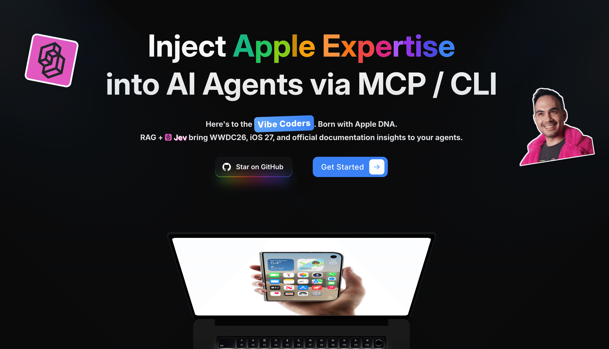
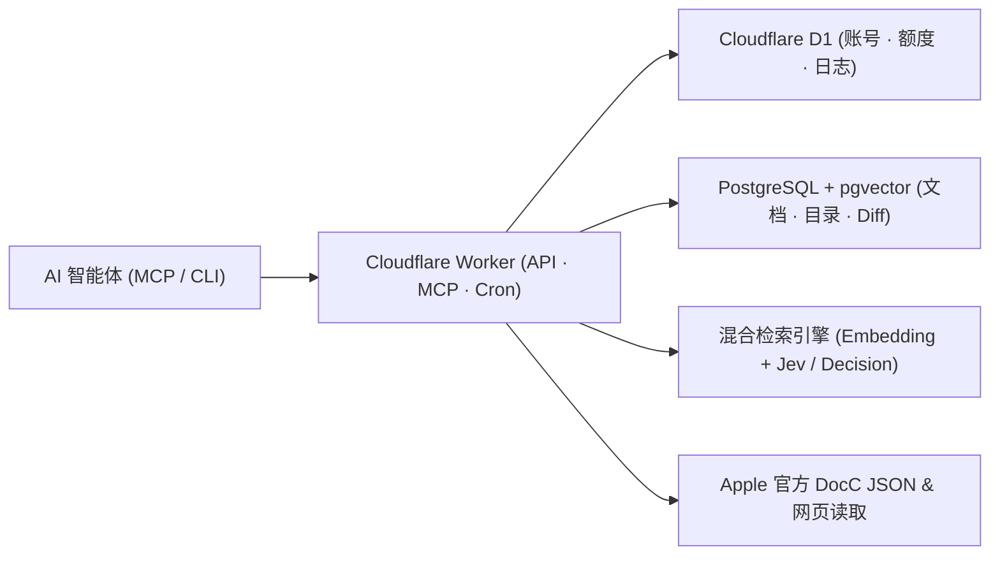

<div align="center">

<a href="https://apple-rag.com">
  
</a>

# Apple RAG

**面向 AI 智能体的 Apple 官方开发文档与 WWDC 字幕知识库，支持 MCP 与 CLI 接入。**

[官网](https://apple-rag.com) · [接入指南](https://apple-rag.com/connect) · [文档动态雷达](https://apple-rag.com/updates) · [npm CLI](https://www.npmjs.com/package/apple-rag-cli) · [English](./README.md) | **简体中文**

[](https://github.com/BingoWon/apple-rag-mcp/actions/workflows/ci.yml)
[](https://github.com/BingoWon/apple-rag-mcp/releases)
[](https://www.npmjs.com/package/apple-rag-cli)
[](https://mcp.apple-rag.com/.well-known/mcp.json)
[](./LICENSE)
[](https://mcpservers.org/servers/bingowon/apple-rag-mcp)
[](https://glama.ai/mcp/servers/BingoWon/apple-rag-mcp)

由 [ **Jev**](https://typesafe.ai/) 与 RAG 混合检索驱动

<br>

<a href="https://apple-rag.com">
  
</a>

<br>

| `376,000+` | `1,880+` | `395,000+` | `每 5 分钟` |
| :---: | :---: | :---: | :---: |
| **Apple 官方文档页** | **WWDC 开发者视频** | **已索引向量分块** | **[实时文档动态雷达](https://apple-rag.com/updates)** |

</div>

---

## 30 秒快速接入

> [!TIP]
> **免注册、免 API Key 直接体验。** 匿名即可开始使用（每周 30 次调用）；随时可在 [apple-rag.com/overview](https://apple-rag.com/overview) 登录获取专属提示词、MCP 令牌、授权 IP 与更高额度。

### 方式一：MCP 接入（推荐）

支持原生 MCP 的智能体直接连接 `https://mcp.apple-rag.com`（Streamable HTTP），或在[接入指南](https://apple-rag.com/connect)一键复制专属接入提示词。

<p>
  <a href="https://cursor.com/en/install-mcp?name=apple-rag-mcp&config=eyJ1cmwiOiJodHRwczovL21jcC5hcHBsZS1yYWcuY29tIiwiaGVhZGVycyI6eyJYLUFwcGxlLVJBRy1DbGllbnQiOiJjdXJzb3IifX0%3D">
    
  </a>
  &nbsp;
  <a href="https://apple-rag.com/connect">
    
  </a>
</p>

**Claude Code**

```bash
claude mcp add-json --scope user apple-rag-mcp '{"type":"http","url":"https://mcp.apple-rag.com","headers":{"X-Apple-RAG-Client":"claude"}}'
```

**Codex（`~/.codex/config.toml`）**

```toml
[mcp_servers.apple-rag-mcp]
url = "https://mcp.apple-rag.com"

[mcp_servers.apple-rag-mcp.http_headers]
X-Apple-RAG-Client = "codex"
```

<details>
<summary><strong>VS Code、TRAE、DeepSeek Harness、WorkBuddy、Antigravity 与通用 JSON 配置</strong></summary>

```json
{
  "mcpServers": {
    "apple-rag-mcp": {
      "type": "http",
      "url": "https://mcp.apple-rag.com"
    }
  }
}
```

- **传输方式：** Streamable HTTP（`https://mcp.apple-rag.com`）
- **协议版本：** 无状态 MCP `2026-07-28`，同时兼容 `2025-11-25`、`2025-06-18`、`2025-03-26` 的 `initialize` 握手
- **账号认证（可选）：** 在[控制台 · MCP 令牌](https://apple-rag.com/mcp-tokens)获取 `Authorization: Bearer <MCP_TOKEN>`，或在[授权 IP](https://apple-rag.com/authorized-ips)绑定固定出口 IP 免令牌访问

</details>

### 方式二：CLI 接入（适合终端型智能体）

具备终端执行能力的智能体（需 Node.js 22.20+）可安装 [`apple-rag-cli`](https://www.npmjs.com/package/apple-rag-cli)，获得与 MCP 完全一致的三项工具及内置 [`apple-dev-docs` 智能体技能](./skills/apple-dev-docs/SKILL.md)。

```bash
npm install -g apple-rag-cli

# 免登录直接试跑
apple-rag search "SwiftUI NavigationStack path binding" --limit 3 --json

# 需要账号额度时通过浏览器完成 OAuth PKCE / 设备授权登录
apple-rag auth login

# 或直接安装内置的 apple-dev-docs 智能体技能
npx skills add BingoWon/apple-rag-mcp
```

完整命令参数、退出码、`--output` 导出、无人值守自动化密钥与 Skill 安装说明见 [`packages/cli/README.md`](./packages/cli/README.md)。

---

## 三大核心工具，一条清晰工作流

MCP 与 CLI 提供完全一致的精简工具集，帮助智能体按需获取精准的 Apple 官方上下文：

| 工具 | 适用场景 | 调用示例 |
| --- | --- | --- |
| `search` | 结合关键词与语义混合检索 Apple 官方文档与 WWDC 字幕（支持英文查询） | `apple-rag search "StoreKit Transaction currentEntitlements" --limit 4` |
| `browse` | 按 Apple 官方主题分组逐层浏览 SwiftUI 与 UIKit 目录，无需猜测链接 | `apple-rag browse "https://developer.apple.com/documentation/swiftui/view" --depth 1` |
| `fetch` | 读取指定官方文档或公开网页原文，返回规范来源与读取方式标记 | `apple-rag fetch "https://developer.apple.com/documentation/swiftui"` |

```text
智能体任务：“iOS 26/27 中 NavigationStack 如何安全绑定路径状态？”

1. search("SwiftUI NavigationStack NavigationPath binding")
   └─▶ 混合召回（精确符号 + pgvector 向量）─▶ 决策模型排序 ─▶ 返回高相关官方片段与来源链接
2. browse("https://developer.apple.com/documentation/swiftui/navigation")  [可选]
   └─▶ 按官方目录查看关联 API 与主题结构
3. fetch("https://developer.apple.com/documentation/swiftui/navigationstack")
   └─▶ 拉取完整文档正文、系统版本可用性与代码示例
```

---

## 为什么选择 Apple RAG

- **混合检索 + 决策模型重排** — 将精确符号/全文检索与 2560 维 `pgvector` 语义召回合并，再由 [ **Jev**](https://typesafe.ai/) 结合查询中的 API、平台与系统版本要求进行相关性排序；中国大陆流量自动路由至 ZenMux 上的 Microsoft Decision 1.1，并在主模型不可用时由 Qwen 自动兜底。
- **Apple Docs Pulse 实时文档雷达** — 每 5 分钟通过 `ETag` 巡检框架入口与发布说明，自动记录结构化 Diff、废弃接口与 Beta 变动，每日/每周生成双语 AI 趋势研报并开放 RSS / JSON 订阅，随时在 [**apple-rag.com/updates**](https://apple-rag.com/updates) 验证数据新鲜度。
- **四级回退网页读取（`fetch`）** — 按「已索引语料 → 新鲜缓存 → Apple 官方 DocC JSON → 实时正文提取」逐级读取，明确标注内容来源与读取路径，并确保站外网页绝不污染 Apple 官方搜索索引。
- **全客户端协议兼容与凭据隔离** — 原生支持无状态 MCP `2026-07-28`，同时保留旧版 `initialize` 握手兼容，确保 Cursor、Claude Code、Codex、VS Code 等开箱即用。MCP 令牌、授权 IP、CLI 设备会话与自动化密钥各自独立可撤销，并共享同一份账号额度。

---

## 套餐与共享额度

`search`、`browse` 与 `fetch` 共享同一套账号额度，覆盖所有 MCP 连接、CLI 设备与自动化密钥，且**已包含全部检索与排序模型调用费用**。

| 方案 | 每周额度 | 速率上限 | 价格 |
| --- | ---: | ---: | --- |
| **匿名体验** | 30 次调用 | 3 次 / 分钟 | 免费（无需注册） |
| **免费账号** | 50 次调用 | 5 次 / 分钟 | 免费（[立即注册](https://apple-rag.com/register)） |
| **Pro** | 50,000 次调用 | 50 次 / 分钟 | **$1 / 周**（支持银行卡与支付宝 · 可选自动订阅或单次通行证） |
| **Enterprise** | 定制额度 | 定制并发 | [联系我们](https://apple-rag.com/#pricing) |

---

## 系统架构与仓库导览

[apple-rag.com](https://apple-rag.com) 托管服务负责语料持续采集、向量库维护与检索模型调度；完整应用源码均在本仓库公开：



| 目录 | 职责说明 |
| --- | --- |
| `worker/` | Cloudflare Worker 服务端 — MCP 协议层（`2026-07-28` + 兼容握手）、REST / CLI OAuth API、混合检索引擎与文档采集雷达 |
| `src/` | React 19 + Vite + Tailwind CSS v4 前端 — 官网、`/connect`、`/updates` 文档动态页、用户控制台与管理后台 |
| `packages/cli/` | 独立发布的 [`apple-rag-cli`](https://www.npmjs.com/package/apple-rag-cli) npm 客户端包 |
| `shared/` | 跨前后端与 CLI 复用的纯类型契约、工具元数据与时间工具 |
| `skills/` | 遵循 Agent Skills 规范的智能体集成说明（`skills/apple-dev-docs/SKILL.md`） |

### 本地开发与校验

```bash
pnpm install
pnpm verify   # 并发执行代码规范与类型检查
pnpm build    # 构建前端与 Cloudflare Worker 生产产物
pnpm dev      # 启动本地 Vite + Worker 开发服务
```

---

## 开源协议

本项目基于 [MIT 协议](./LICENSE) 开源。

<div align="center">

<br>

**更好的文档。更好的上下文。更好的代码。**

[立即开始 →](https://apple-rag.com) · [查看文档动态雷达 →](https://apple-rag.com/updates)

</div>
