# Apple RAG 全局架构与设计意图索引

> 更新时间：2026-11-24（基于 `v5.15.13` / `apple-rag-cli@2.1.4`）  
> 用途：面向后续维护者与智能体的**全局导航、演进时间线与意图说明书**。当你看到仓库中某段“看起来特殊或反直觉”的代码、配置或文案时，可先查本文档定位其业务背景与带日期的原始记录，避免误改历史约束。

---

## 1. 产品定位与核心边界

Apple RAG 是一款**面向 AI 智能体**的 Apple 开发者知识检索服务，同时提供 **MCP** 与 **CLI** 两种接入方式：

- **面向谁**：人类用户负责选择套餐、登录账号、批准设备或管理令牌；**AI 智能体**负责执行 `search → browse → fetch`。CLI 的定位是给具备 shell 执行能力的智能体使用，而非取代人类的手工文档阅读（见 [`ops/brand-agent-content-2026-11-03.md`](./brand-agent-content-2026-11-03.md)）。
- **核心工具顺序（Canonical Order）**：`search`（混合搜索 + 决策排序）→ `browse`（按框架浏览主题目录）→ `fetch`（按 URL 读取正文）。见 [`shared/tool-activity.ts`](../shared/tool-activity.ts) 与 [`ops/retrieval-terminology.md`](./retrieval-terminology.md)。
- **账号与凭据边界**：同一套平台账号、订阅权益与周/分钟共享配额（匿名 30/周・3/分；免费注册 50/周・5/分；Pro 50,000/周・50/分，\$1/周），但 **MCP 与 CLI 凭据严格隔离、互不通用**：
  - MCP：`https://mcp.apple-rag.com`，使用 `at_` 令牌或 IP 白名单。
  - CLI：`https://apple-rag.com/api/cli/v1`，使用 OAuth PKCE / Device Grant 登录获得的设备会话（`ar_cli_a_` / `ar_cli_r_`），或网页签发的自动化密钥（`ar_cli_k_`）。

---

## 2. 系统顶层架构

```mermaid
flowchart LR
    subgraph Clients["外部调用方"]
        MCPClient["MCP 智能体\nCursor / Claude Code / VS Code / Codex 等"]
        CLIClient["Shell 智能体\napple-rag-cli (npm + SKILL.md)"]
        Browser["人类用户浏览器\n官网 / 控制台 / 运营后台"]
    end

    subgraph Edge["Cloudflare Worker (worker/index.ts)"]
        SiteApp["apple-rag.com\n静态资源 + HTMLRewriter + /api/* + /mcp"]
        MCPApp["mcp.apple-rag.com\nMCP 专用入口 + /.well-known/mcp.json"]
        Cron["Cron Triggers\n*/5 采集与维护 · 7 * 账单对账"]
    end

    subgraph State["边缘业务库 (Cloudflare D1)"]
        D1[("apple-rag-db\n账号 / 会话 / 令牌 / 额度\n调用日志 / 模型计量 / 发票")]
    end

    subgraph Corpus["VPS 数据层 (SSH: apple-rag)"]
        PG[("PostgreSQL 16 + pgvector\npages / chunks / catalog\nweb_page_cache")]
        CatalogJob["systemd 定时任务\npublish_catalog.py"]
    end

    subgraph Upstream["外部依赖服务"]
        Embed["Embedding\nSiliconFlow / DeepInfra"]
        Rank["决策排序与兜底\nZenMux (CN: Microsoft Decision 1.1)\nTypeSafe (Non-CN: Jev) / DeepInfra Qwen"]
        WebFetch["实时读取\nApple Official JSON / Firecrawl"]
        Biz["商业与通知\nStripe / Resend / Google & GitHub OAuth / Telegram"]
    end

    MCPClient -->|Streamable HTTP| MCPApp
    CLIClient -->|JSON API + OAuth| SiteApp
    Browser -->|HTTPS| SiteApp

    SiteApp & MCPApp & Cron --> D1
    SiteApp & MCPApp & Cron --> PG
    CatalogJob --> PG

    SiteApp & MCPApp --> Embed & Rank & WebFetch
    SiteApp & Cron --> Biz
    Cron --> Embed & WebFetch
```

---

## 3. 代码库模块版图（单向依赖边界）

> 架构约束（2026-11-24 收口）：`shared/` 不依赖 `worker/` 或 `src/`；`src/` 不直接依赖 `worker/`；`worker/` 不反向依赖 `src/`。

| 目录 / 文件 | 职责定位 | 关键入口 |
| --- | --- | --- |
| `shared/` | 跨前端、Worker、CLI 共享的纯契约、类型与元数据 | [`contracts.ts`](../shared/contracts.ts)、[`browse.ts`](../shared/browse.ts)、[`site.ts`](../shared/site.ts)、[`mcp-clients.ts`](../shared/mcp-clients.ts)、[`tool-activity.ts`](../shared/tool-activity.ts)、[`tool-channels.ts`](../shared/tool-channels.ts)、[`tool-outcomes.ts`](../shared/tool-outcomes.ts)、[`admin-user.ts`](../shared/admin-user.ts)、[`admin-stats.ts`](../shared/admin-stats.ts)、[`datetime.ts`](../shared/datetime.ts) |
| `worker/index.ts` | Worker 总路由（按 Hostname 分发 `mcpApp` / `app`）、全局错误告警初始化与双 Cron 入口 | [`worker/index.ts`](../worker/index.ts)、[`worker/site-pages.ts`](../worker/site-pages.ts) |
| `worker/mcp/` & `worker/mcp-auth/` | MCP 协议层（双时代握手、三工具统一注册、响应格式化、令牌/IP 鉴权） | [`protocol-handler.ts`](../worker/mcp/protocol-handler.ts)、[`tools.ts`](../worker/mcp/tools.ts)、[`manifest.ts`](../worker/mcp/manifest.ts)、[`auth-middleware.ts`](../worker/mcp-auth/auth-middleware.ts) |
| `worker/cli/` | CLI 独立 OAuth 2.0（PKCE + Device Grant）、RFC 7009 撤销、`/api/cli/v1` 工具路由 | [`authorization.ts`](../worker/cli/authorization.ts)、[`routes.ts`](../worker/cli/routes.ts) |
| `worker/services/` | 核心领域服务：统一工具调度、混合检索、地区排序、目录浏览、网页读取、限流、日志、告警 | [`tool-service.ts`](../worker/services/tool-service.ts)、[`search-engine.ts`](../worker/services/search-engine.ts)、[`reranker.ts`](../worker/services/reranker.ts)、[`embedding.ts`](../worker/services/embedding.ts)、[`catalog.ts`](../worker/services/catalog.ts)、[`page-reader.ts`](../worker/services/page-reader.ts)、[`rate-limit.ts`](../worker/services/rate-limit.ts) |
| `worker/api/` | 官网与控制台 REST API（Hono + Zod OpenAPI）、账密/OAuth、Stripe 结账与对账、运营后台 | [`app.ts`](../worker/api/app.ts)、[`routes/stripe.ts`](../worker/api/routes/stripe.ts)、[`services/billing-reconciliation.ts`](../worker/api/services/billing-reconciliation.ts)、[`routes/admin/`](../worker/api/routes/admin/index.ts) |
| `worker/collector/` | 定时内容采集器：Apple DocC JSON 抓取、WWDC HLS 字幕解析、分块、向量化入库 | [`handler.ts`](../worker/collector/handler.ts)、[`AppleDocCollector.ts`](../worker/collector/AppleDocCollector.ts)、[`AppleAPIClient.ts`](../worker/collector/AppleAPIClient.ts) |
| `worker/shared/` | Worker 侧底层工具（PG 重试、Telegram、URL/SSRF 校验、全局告警日志） | [`postgres-retry.ts`](../worker/shared/postgres-retry.ts)、[`web-url.ts`](../worker/shared/web-url.ts)、[`url-utils.ts`](../worker/shared/url-utils.ts)、[`logger.ts`](../worker/shared/logger.ts) |
| `packages/cli/` | 独立发版的 npm 包 `apple-rag-cli`（可执行文件 `apple-rag`） | [`cli.ts`](../packages/cli/src/cli.ts)、[`client.ts`](../packages/cli/src/client.ts)、[`login.ts`](../packages/cli/src/login.ts)、[`credentials.ts`](../packages/cli/src/credentials.ts) |
| `skills/apple-dev-docs/` | 遵循 Agent Skills 规范的技能说明书与 OpenAI/Codex 元数据 | [`SKILL.md`](../skills/apple-dev-docs/SKILL.md)、[`agents/openai.yaml`](../skills/apple-dev-docs/agents/openai.yaml) |
| `src/` | React 19 + Vite + Tailwind v4 前端（官网、`/connect`、用户控制台、CLI 授权页、运营后台） | [`router.tsx`](../src/router.tsx)、[`pages/HomePage.tsx`](../src/pages/HomePage.tsx)、[`pages/ConnectPage.tsx`](../src/pages/ConnectPage.tsx)、[`i18n/`](../src/i18n/index.ts) |
| `migrations/` | Cloudflare D1 增量迁移（`0003`–`0019`） | [`migrations/`](../migrations/) |
| `ops/` | 运维配置、VPS PostgreSQL 脚本、架构规范、事故复盘、全局审查与评测脚本 | [`ops/README.md`](./README.md)、[`ops/server/`](./server/)、[`ops/incidents/`](./incidents/)、[`ops/reviews/`](./reviews/) |
| `patches/` | pnpm 依赖补丁 | [`patches/postgres@3.4.9.patch`](../patches/postgres@3.4.9.patch) |

---

## 4. 关键数据流速览

### 4.1 `search`（混合检索 + 地区路由排序）
1. **配额预留**：在 D1 通过 `quota_reservations` + SQLite 触发器原子预留周/分钟额度（失败或客户端取消自动按 `request_id` 退款）。
2. **并行双路召回**（[`worker/services/search-engine.ts`](../worker/services/search-engine.ts)）：
   - **语义路**：在线 Embedding 按 `SiliconFlow (3s) → DeepInfra (3s) → SiliconFlow (5s) → DeepInfra (5s)` 顺序在 16 秒总预算内生成 2560 维 L2 归一化向量，查 PostgreSQL `chunks` 的 `pgvector` `halfvec` 索引（4N 候选）。
   - **关键词路**：先查 `chunk_index = 0` 的精确符号索引，再补 `to_tsvector('simple', ...)` 有界全文检索（4N 候选）。
   - 任一路径失败另一路仍可降级返回（向量不可用记 `SEMANTIC_UNAVAILABLE`）。
3. **同 URL 合并与地区决策排序**（[`worker/services/reranker.ts`](../worker/services/reranker.ts)）：
   - 同 URL 多分块合并后保留真实 `total_chunks` 以精确判定文档是否完整。
   - 依据 Cloudflare `request.cf.country` 选择主排序器（单次 5s 超时，64 KB 字节预算，0–3 四档评分）：
     - `CN`：首选 ZenMux `microsoft/microsoft-decision-1.1` → 失败切 DeepInfra `Qwen/Qwen3-Reranker-8B`（`RERANKER_FALLBACK`）。
     - 非 `CN` / 未知：首选 TypeSafe `jev-latest` → 遇明确地区 HTTP 451 直接切 Qwen；其他错误若配 `ZENMUX_API_KEY` 先试 `typesafe/jev-1.14`，再切 Qwen。
     - 兜底也失败则保留检索顺序返回并记 `RERANKING_UNAVAILABLE`。

### 4.2 `browse`（只读主题目录）
- 读取 VPS PostgreSQL 中由 `publish_catalog.py` 每小时原子发布的 `catalog_sources` / `catalog_nodes`（当前试点覆盖 SwiftUI 与 UIKit 默认语言视图）。
- 在 `REPEATABLE READ READ ONLY` 事务（5s 超时）中做有界 BFS 展开（深度 1–3，默认 2；分支上限 8 项、总条目上限 50、附加紧凑 JSON 上限 8 KiB），分页带 `revision` 摘要校验，变更时返回 `LIST_CHANGED`。不调用任何外部模型或实时抓取。见 [`ops/catalog.md`](./catalog.md)。

### 4.3 `fetch`（四级回退读取）
- 解析顺序：PostgreSQL 索引 `pages` → 新鲜缓存 `web_page_cache`（24h 有效，确认 404/410 负缓存 5m）→ 官方 Apple JSON（通过 `canCacheUrl` 校验且成功后才回队列给采集器）→ Firecrawl 单页 Markdown 抽取（每日全局 UTC 原子配额 `FIRECRAWL_DAILY_LIMIT`，默认 25；实耗外部 Firecrawl 预算后的目标站报错不再退还用户配额）。
- 第三方网页允许读取并缓存，但**绝不自动进入** Apple 搜索语料库（`pages`/`chunks`）；含查询参数的 URL 跳过共享缓存。见 [`ops/web-retrieval.md`](./web-retrieval.md)。

---

## 5. 特殊设计与“有意为之”的约束索引（Why-Map）

> 以下条目均为历史上踩过坑或经所有者明确拍板的设计决策。重构或“清理代码”前务必先核对对应依据。

| 你看到的特殊实现 | 为什么这样设计（真实意图） | 权威依据 |
| --- | --- | --- |
| `worker/mcp/protocol-handler.ts` 保留 `legacy: "stateless"` | 2026-10-19 曾因改为 `legacy: "reject"` 导致 Cursor 3.24.18 等使用 `initialize` 握手的客户端全线不可用。必须在支持 `2026-07-28` 的同时保留旧握手兼容，严禁擅自收窄。 | [`ops/incidents/2026-10-19-cursor-mcp-protocol.md`](./incidents/2026-10-19-cursor-mcp-protocol.md) |
| `patches/postgres@3.4.9.patch` 对 `Socket.write` 排队并按 32 KiB 切块 | Cloudflare `workerd` 在单次 TCP socket 写入超过 64 KiB 时可能异常断开连接；该补丁串行化写队列并将写缓冲限制在 32,768 字节内。 | [`patches/postgres@3.4.9.patch`](../patches/postgres@3.4.9.patch)、[`ops/collector/postgres-socket.test.mjs`](./collector/postgres-socket.test.mjs) |
| `worker/services/reranker.ts` 按 `request.cf.country === "CN"` 分流到微软决策模型 | TypeSafe 官方 API 对中国大陆访客返回地区 HTTP 451，ZenMux 代理 Jev 亦曾返回上游 400。按访客国家直接路由可消除无效等待和告警噪音。 | [`ops/incidents/2026-11-22-jev-region.md`](./incidents/2026-11-22-jev-region.md) |
| 在线 `embedding.ts` 用 3s/5s 两轮 16s 预算，而 `collector/EmbeddingProvider.ts` 用 30s/120s | 在线搜索要尽快失败切换或降级关键词检索以保交互延迟；后台采集批量处理最多 32 条文本，需要更宽裕超时，两者不可合并套用。 | [`ops/admin-dashboard-stats.md`](./admin-dashboard-stats.md)、[`ops/collector/README.md`](./collector/README.md) |
| `robots.txt` 不禁止 `/overview`、`/login`、`/admin` 等前端路径 | 为了让搜索引擎能够抓取到这些路由的 HTML 并读取 Worker `HTMLRewriter` 注入的 `noindex` 元标签与 `X-Robots-Tag` 响应头；若在 `robots.txt` 中 `Disallow`，搜索引擎反而无法看到 `noindex`。 | [`ops/brand-metadata-audit-2026-11-03.md`](./brand-metadata-audit-2026-11-03.md)、[`worker/site-pages.ts`](../worker/site-pages.ts) |
| 首页 Hero 保留彩色标题、彩虹 GitHub Star 按钮、滚动 MacBook、快速接入两按钮且不展示提示词预览 | 所有者明确要求的视觉与交互规范：彩虹按钮固定为 GitHub Star；快速接入只放两个直接复制提示词按钮，不渲染提示词全文或终端预览；客户端徽标栏保持宽容器横向换行。 | [`ops/brand-agent-content-2026-11-03.md`](./brand-agent-content-2026-11-03.md) |
| `subscription_receipts` 与 `user_subscriptions` 分表维护 | `user_subscriptions` 只表达当前有效权益；财务收款历史以 `subscription_receipts` 的已支付发票为准，并由每小时 Cron 在 Stripe 30 天事件过期窗口内（25 天阈值）对账补全。 | [`ops/admin-billing-overview.md`](./admin-billing-overview.md)、[`ops/account-integrity.md`](./account-integrity.md) |
| 显式携带 `Authorization` 头时认证失败返回 401，绝不降级到 IP 或匿名 | 防止客户端携带已吊销/过期令牌时静默退回匿名额度，误导用户和智能体。多账号绑定同一 IP 时安全降级为匿名。 | [`ops/incidents/2026-11-03-mcp-production-boundaries.md`](./incidents/2026-11-03-mcp-production-boundaries.md)、[`ops/account-integrity.md`](./account-integrity.md) |
| D1 数据层与 VPS PostgreSQL 严禁合并 | 语料、向量、目录与网页缓存固定在自管 VPS PostgreSQL；Cloudflare D1 仅存轻量应用状态与日志，不把检索语料迁移至 Cloudflare 托管存储。 | [`ops/README.md`](./README.md)、[`ops/web-retrieval.md`](./web-retrieval.md) |
| 运营后台用 `INSTR` 过滤日志、`julianday()` 比较时间、禁止 `SELECT *` 迁移 | 2026-11-03 事故教训：D1 `LIKE` 有 50 字节模式上限且有通配符注入风险；历史日志混存 SQLite 与 ISO 时间格式；`INSERT INTO ... SELECT *` 曾导致列错位并耗尽 D1 写入配额。 | [`ops/incidents/2026-11-03-admin-log-recovery.md`](./incidents/2026-11-03-admin-log-recovery.md) |
| 发布流程：推送 `main` 即部署，服务端与 CLI 版本独立 | Cloudflare Workers Builds 监听 `main` 自动构建部署，不走手工 `wrangler deploy`。服务端代码改动同步提升根 `package.json` 和 `server.json`；CLI 改版提升 `packages/cli/package.json` 及 `SKILL.md` 版本并在 CI 通过 npm OIDC + `--provenance` 发布。 | [`ops/README.md`](./README.md)、[`ops/cli.md`](./cli.md) |
| SPA 三层部署防漂移（HTML 禁缓存 + 静态资源 `immutable` + `lazyWithRecovery` / `X-App-Version` + 主题化分层 `ErrorBoundary`） | Cloudflare Workers Static Assets 每次部署原子替换带 hash 的 `/assets/*`；若 HTML 被 CDN 缓存或长驻标签页持有旧清单，切换路由会触发 404 导致白屏报错。通过移除 Zone `Cache Everything`、HTML 返回 `no-store` + `CDN-Cache-Control: no-store`、`public/_headers` 标记 `/assets/*` 一年 `immutable`、`/assets/*` 404 禁缓存、API 附带 `X-App-Version`、前端统一 `lazyWithRecovery` 与分层自动复位 `ErrorBoundary` 根治发版报错。 | [`public/_headers`](../public/_headers)、[`worker/site-pages.ts`](../worker/site-pages.ts)、[`src/lib/deployment-recovery.ts`](../src/lib/deployment-recovery.ts)、[`src/components/ErrorBoundary.tsx`](../src/components/ErrorBoundary.tsx) |
| Apple 官方文档动态雷达与 AI 趋势研报（`/updates` + 双轨 `ETag` 采集 + Workers AI 免费额度优先） | 通过双轨调度（每 5 分钟对 ~923 个框架根与发布说明做高频雷达 + 全量 `If-None-Match` 304 跳过）与事务内结构化 DocC/Markdown Diff，将变更事件、巡检心跳与双语日报/周报落库 VPS PostgreSQL（不占 D1 配额）。AI 研报于每日 `00:07 UTC` 优先走 Cloudflare Workers AI 免费额度（`deepseek-v4.1-flash-1017 → gpt-oss-120b → gemma-4-26b-a4b-it`，日预算硬上限 8,000 Neurons），故障时按需降级 ZenMux 与纯规则保底，并在 `/updates`（含 RSS/JSON Feed）与 `/overview` 语料卡片脉冲条公开展示以自证数据新鲜度。 | [`ops/server/postgresql_doc_updates.sql`](./server/postgresql_doc_updates.sql)、[`worker/collector/change-detector.ts`](../worker/collector/change-detector.ts)、[`worker/services/doc-digest.ts`](../worker/services/doc-digest.ts)、[`worker/api/routes/updates.ts`](../worker/api/routes/updates.ts)、[`src/pages/UpdatesPage.tsx`](../src/pages/UpdatesPage.tsx) |
| 单一语义 Token 设计系统（Tailwind v4 `@theme inline` + `@custom-variant dark` + `ui/` 与 `effects/` 分层） | 摒弃早期冲突的双套 CSS 变量与失效的媒体查询 `dark:` 机制，全站统一为 `:root` 亮色基准 + `.dark` 暗色覆写 + `color-scheme` + 16 枚核心语义 Token，并通过 `src/components/ui/`（核心交互原语）与 `src/components/effects/`（营销动效组件）清晰解耦；回归测试锁定零旧 Token、零废弃变量与零禁色 `#2563eb`。 | [`src/styles/globals.css`](../src/styles/globals.css)、[`src/utils/designSystem.test.ts`](../src/utils/designSystem.test.ts) |

---

## 6. 演进与决策时间线（2026-10-08 → 2026-11-24）

> 按时间正序索引项目历史上所有关键架构演进、事故复盘与审查记录，方便回溯每项设计的来龙去脉。

| 日期 | 里程碑 / 事件 | 对应文档 |
| --- | --- | --- |
| **2026-10-08** | Jev 决策模型首次检索相关性评测报告上线 | [`ops/jev/report-2026-10-08.md`](./jev/report-2026-10-08.md) |
| **2026-10-19** | Cursor 3.24 MCP 握手兼容事故复盘，确立 `legacy: "stateless"` 铁律 | [`ops/incidents/2026-10-19-cursor-mcp-protocol.md`](./incidents/2026-10-19-cursor-mcp-protocol.md) |
| **2026-11-03** | D1 `0007` 日志表迁移错位与写配额耗尽事故复盘 | [`ops/incidents/2026-11-03-admin-log-recovery.md`](./incidents/2026-11-03-admin-log-recovery.md) |
| **2026-11-03** | MCP 生产鉴权 fail-closed 与限流边界验收 | [`ops/incidents/2026-11-03-mcp-production-boundaries.md`](./incidents/2026-11-03-mcp-production-boundaries.md) |
| **2026-11-03** | Agent-first 品牌、首页与 `/connect` 视觉/文案约束基线确立 | [`ops/brand-agent-content-2026-11-03.md`](./brand-agent-content-2026-11-03.md) |
| **2026-11-03** | SEO 元数据、`HTMLRewriter`、`llms.txt` 与 OG 审计 | [`ops/brand-metadata-audit-2026-11-03.md`](./brand-metadata-audit-2026-11-03.md) |
| **2026-11-03** | `apple-rag-cli` 首次 npm 发版、独立 OAuth 2.0 授权架构、UI 与生产验收 | [`ops/cli-auth-architecture.md`](./cli-auth-architecture.md)、[`ops/cli-acceptance-2026-11-03.md`](./cli-acceptance-2026-11-03.md)、[`ops/cli-auth-acceptance-2026-11-03.md`](./cli-auth-acceptance-2026-11-03.md)、[`ops/cli-ui-2026-11-03.md`](./cli-ui-2026-11-03.md) |
| **2026-11-03** | 自动化测试策略盘点 | [`ops/testing-audit-2026-11-03.md`](./testing-audit-2026-11-03.md) |
| **2026-11-16** | ZenMux System One 协议（`typesafe/jev-1.14`）备用重排接入与计费基线 | [`ops/jev/zenmux.md`](./jev/zenmux.md) |
| **2026-11-19** | `browse` 只读主题目录（SwiftUI / UIKit 试点）发布上线 | [`ops/catalog.md`](./catalog.md) |
| **2026-11-22** | 中国大陆流量切换 ZenMux Microsoft Decision 1.1 地区路由实证与复盘 | [`ops/incidents/2026-11-22-jev-region.md`](./incidents/2026-11-22-jev-region.md) |
| **2026-11-24** | 项目交接后全项目顶层深度审查、安全与 Bug 系统整改、架构边界收口、包体瘦身、非首页中文润色与首页/README 文案提案（`v5.15.13` / `cli@2.1.4`） | [`ops/reviews/2026-11-24-global-review-and-remediation.md`](./reviews/2026-11-24-global-review-and-remediation.md) |

---

## 7. 现有 `ops/` 专题文档导航

| 类别 | 文档 | 覆盖内容 | 维护状态（2026-11-24） |
| --- | --- | --- | --- |
| **全局与审查** | [`ops/reviews/2026-11-24-global-review-and-remediation.md`](./reviews/2026-11-24-global-review-and-remediation.md) | 2026-11-24 全局审查、量化整改、VPS 操作步骤与首页/README 文案提案 | 最新 |
| **运维基线** | [`ops/README.md`](./README.md) | VPS PG 备份、自动发布流程、D1 迁移前置规则、UI 验证 | 已同步 |
| **检索与模型** | [`ops/retrieval-terminology.md`](./retrieval-terminology.md) | 工具顺序与检索/排序术语规范 | 最新 |
| | [`ops/incidents/2026-11-22-jev-region.md`](./incidents/2026-11-22-jev-region.md) | 大陆 Microsoft Decision 1.1 与非大陆 Jev 路由实证 | 最新 |
| | [`ops/jev/zenmux.md`](./jev/zenmux.md) | ZenMux System One 接入说明（已补大陆路由交叉索引） | 已同步 |
| | [`ops/catalog.md`](./catalog.md) | `browse` 目录规则与 VPS 发布机制（已修正 `ops/server/` 路径） | 已同步 |
| | [`ops/web-retrieval.md`](./web-retrieval.md) | `fetch` 实时读取、缓存、SSRF 与 8 种工具 outcome | 有效 |
| **采集与语料** | [`ops/collector/README.md`](./collector/README.md) | 采集批量、超时预算、删除保护与覆盖率口径 | 最新 |
| **CLI 与客户端** | [`ops/cli-auth-architecture.md`](./cli-auth-architecture.md) | CLI OAuth 2.0、HKDF、Keyring 与凭据隔离（已更新设置入口） | 已同步 |
| | [`ops/cli.md`](./cli.md) | CLI 架构、发版门禁、OIDC 与 `--provenance` 说明 | 已同步 |
| | [`ops/mcp-client-audit.md`](./mcp-client-audit.md) | 各 MCP 客户端配置格式与统一安装提示词审计 | 有效 |
| **账号、账单与后台** | [`ops/account-integrity.md`](./account-integrity.md) | 会话隔离、IP 共享降级、原子配额、Stripe 幂等对账（已补 `0018`–`0019` 说明） | 已同步 |
| | [`ops/admin-billing-overview.md`](./admin-billing-overview.md) | 发票收款历史与定时对账逻辑 | 最新 |
| | [`ops/admin-dashboard-stats.md`](./admin-dashboard-stats.md) | 模型费用计量、在线 Embedding 重试分析 SQL 与看板指标（已补 9 页/8 outcome 修订注） | 已同步 |
| | [`ops/admin-channel-stats.md`](./admin-channel-stats.md) | MCP/CLI 渠道与 `X-Apple-RAG-Client` 客户端统计 | 最新 |
| | [`ops/admin-user-names.md`](./admin-user-names.md) | 后台身份脱敏、当前套餐徽章与统一查询规范（已补 `browse_logs`） | 已同步 |
| **品牌与历史审计** | [`ops/brand-agent-content-2026-11-03.md`](./brand-agent-content-2026-11-03.md) | 首页、`/connect`、文案与视觉保留规则（历史基线，仓库现已公开） | 历史基线 |
| | [`ops/brand-metadata-audit-2026-11-03.md`](./brand-metadata-audit-2026-11-03.md) | SEO 元数据、`HTMLRewriter`、`llms.txt` 与 OG 审计 | 历史基线 |
| | [`ops/testing-audit-2026-11-03.md`](./testing-audit-2026-11-03.md) | 早期测试策略盘点（Stripe/限流/安全缺口均已补齐） | 历史记录 |
| **事故复盘** | [`ops/incidents/2026-10-19-cursor-mcp-protocol.md`](./incidents/2026-10-19-cursor-mcp-protocol.md) | Cursor 3.24 MCP 握手兼容事故 | 长期有效 |
| | [`ops/incidents/2026-11-03-admin-log-recovery.md`](./incidents/2026-11-03-admin-log-recovery.md) | D1 `0007` 迁移错位与写配额耗尽事故 | 长期有效 |
| | [`ops/incidents/2026-11-03-mcp-production-boundaries.md`](./incidents/2026-11-03-mcp-production-boundaries.md) | MCP 认证 fail-closed 与限流/结果边界 | 长期有效 |
